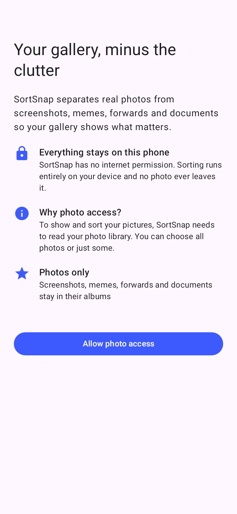
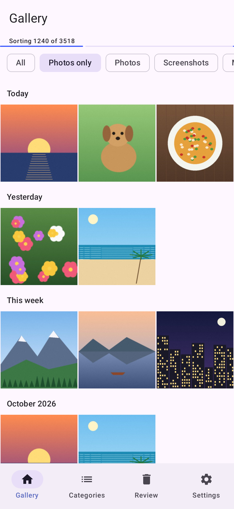
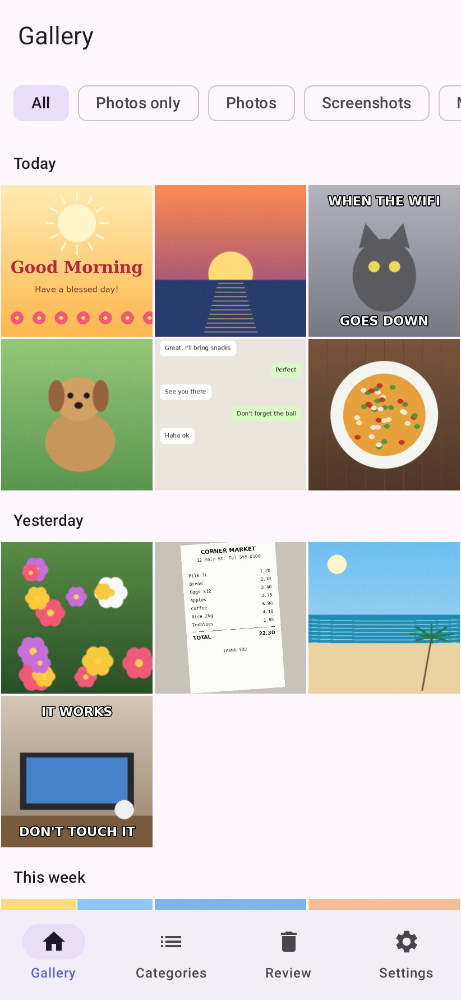
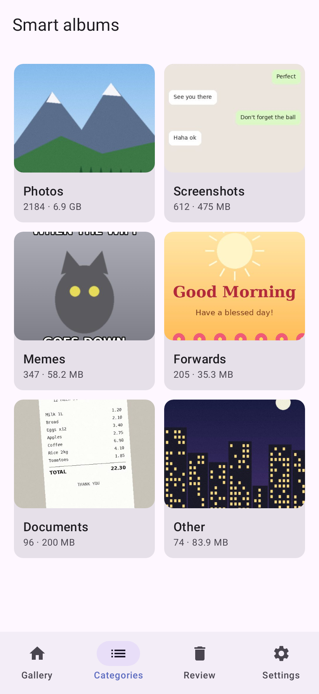
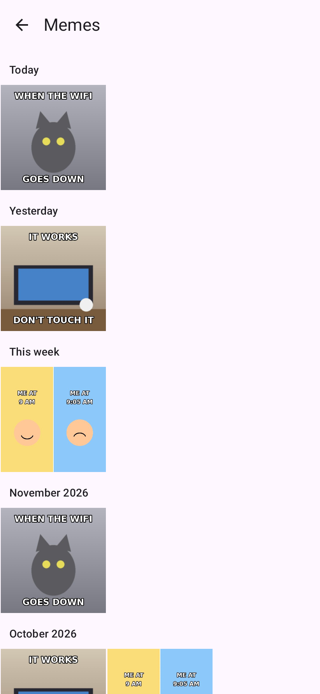
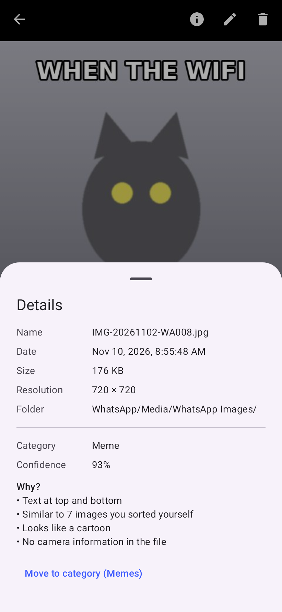
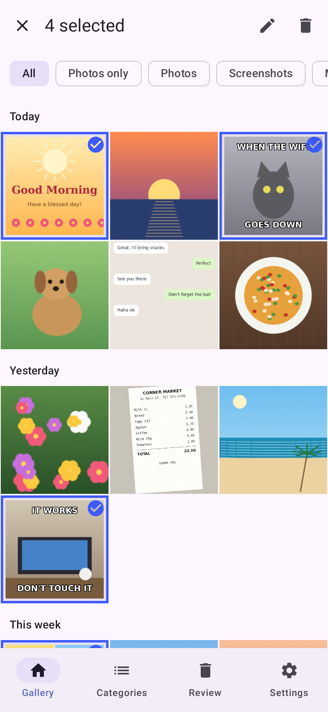
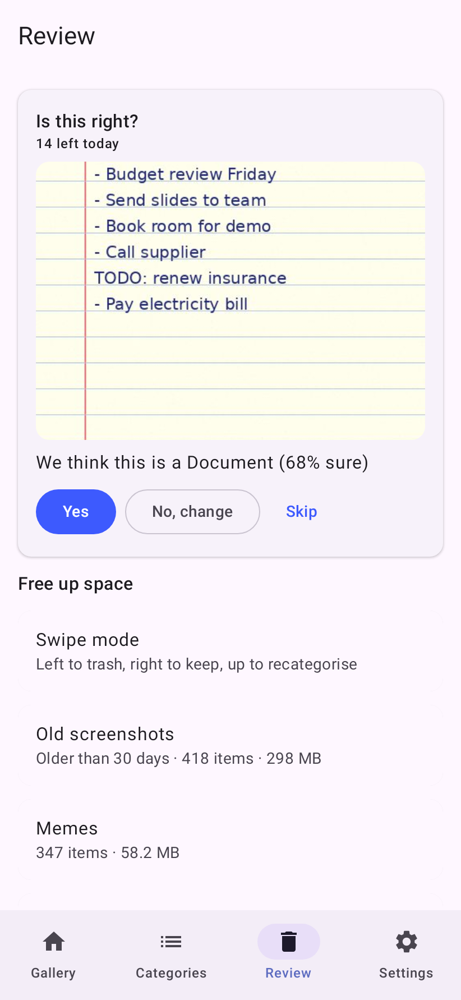
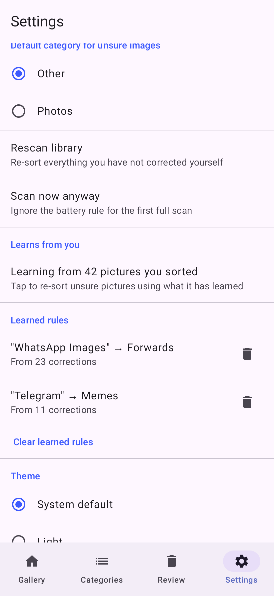

# SortSnap

An Android photo gallery that automatically separates real photos from clutter (screenshots, memes,
forwards, documents), 100% on-device.

- Kotlin · Jetpack Compose · Material 3 · Hilt · Room · WorkManager · Paging 3 · Coil 3
- ML Kit Text Recognition + Image Labeling (bundled, offline)
- No `INTERNET` permission. Nothing leaves the phone.

See [CLAUDE.md](CLAUDE.md) for the architecture, rules and build progress.

## Getting started

Nine steps through the app, with a screenshot of each screen.

> The screenshots are the app's real screens rendered with sample pictures (drawn illustrations, not
> anyone's photos). Your phone's colours may differ: SortSnap follows your wallpaper colours on
> Android 12 and newer.

<table>
<tr>
<td width="280" valign="top"></td>
<td valign="top">

### 1. Allow photo access

The first screen explains what SortSnap does and that nothing leaves your phone. Tap
**Allow photo access**.

- On Android 14 and newer you can pick **All photos** or only some. With only some, a banner at the
  top of the gallery lets you allow the rest later.
- If you said no by mistake, the screen offers a button to open the app's system settings.

</td>
</tr>
<tr>
<td width="280" valign="top"></td>
<td valign="top">

### 2. Your gallery, sorted as it scans

Your pictures appear straight away, grouped by **Today, Yesterday, This week** and month.

- The thin bar under the title shows sorting progress (*Sorting 1240 of 3518*). It runs in the
  background, so you can keep using the app or close it.
- The first full sort waits until your phone is charging or above 30 % battery. To start anyway, go to
  Settings › **Scan now anyway**.
- **Photos only** is on by default: screenshots, memes, forwards and documents are kept out of the
  main view. Nothing is deleted.
- Pinch the grid to switch between 3, 4 and 5 columns.

</td>
</tr>
<tr>
<td width="280" valign="top"></td>
<td valign="top">

### 3. Filter what you see

Use the chips under the title:

- **All** shows every picture, including the clutter.
- **Photos only** hides the clutter (the default).
- **Photos, Screenshots, Memes, Forwards, Documents, Other** show one category.

Tap a picture to open it full screen. Swipe left and right to move between pictures, pinch or
double-tap to zoom.

</td>
</tr>
<tr>
<td width="280" valign="top"></td>
<td valign="top">

### 4. Browse by category

The **Categories** tab shows a smart album for each category, with how many pictures it holds and how
much space they use. The numbers update live while sorting runs.

**Other** holds pictures SortSnap is not sure about. They are never hidden, so nothing goes missing.

</td>
</tr>
<tr>
<td width="280" valign="top"></td>
<td valign="top">

### 5. Open an album

Tap a tile to open that album. It works like the gallery: tap to view, long-press to select.

</td>
</tr>
<tr>
<td width="280" valign="top"></td>
<td valign="top">

### 6. See why a picture was sorted

In the full-screen viewer, tap **ⓘ** to open the details. Next to the file name, date, size and
folder you see the **category**, how **confident** SortSnap is, and a **Why?** list in plain words,
for example *Text at top and bottom* or *Similar to 7 images you sorted yourself*.

The other buttons at the top: ✏️ moves the picture to another category, 🗑 sends it to the trash.

</td>
</tr>
<tr>
<td width="280" valign="top"></td>
<td valign="top">

### 7. Fix mistakes (SortSnap learns from them)

Long-press a picture to start selecting, then tap more pictures. In the bar at the top:

- ✏️ **Move to category**: pick the right category. Your choice always wins and a rescan never
  changes it back.
- 🗑 **Trash**: Android asks you to confirm. On Android 11 and newer, trashed pictures can be
  restored for 30 days.

Every correction teaches SortSnap. After about 5 corrections from the same folder, it learns a
folder rule (for example *WhatsApp Images → Forwards*). Pictures that look like ones you sorted
yourself get sorted the same way.

</td>
</tr>
<tr>
<td width="280" valign="top"></td>
<td valign="top">

### 8. Review: confirm and free up space

The **Review** tab has two parts:

- **Is this right?** Each day SortSnap shows up to 20 pictures it is unsure about. Tap **Yes**,
  **No, change** (pick the right category) or **Skip**. A few taps a day makes sorting noticeably
  better.
- **Free up space**: old screenshots (over 30 days), memes, forwards, near-duplicates (the largest
  copy is kept) and blurry photos, each with how much space you would get back. Open a section,
  tap pictures to keep them, and trash the rest. Or try **Swipe mode**: left to trash, right to keep,
  up to change the category, with undo.

</td>
</tr>
<tr>
<td width="280" valign="top"></td>
<td valign="top">

### 9. Settings

- **Hide clutter from main gallery**: turn Photos only on or off by default.
- **Default category for unsure images**: *Other* (safest) or *Photos*.
- **Rescan library** re-sorts everything you have not corrected yourself.
- **Learns from you** shows how many of your corrections it is using. Tap it to re-sort unsure
  pictures with what it has learned.
- **Learned rules** lists folder rules. Tap 🗑 to delete one you disagree with.
- **Theme**: system default, light or dark. **Dynamic colour** follows your wallpaper colours.

</td>
</tr>
</table>

### Good to know

- SortSnap never deletes anything without asking you. Android shows its own confirmation every time.
- Your corrections are kept when you rescan or update the app.
- Big libraries (50,000+ pictures) are fine: sorting happens in the background in small batches.

<sub>The screenshots come from `app/src/test/kotlin/com/sortsnap/ui/GuideScreenshots.kt` (Robolectric,
no emulator) with sample pictures from `tools/generate_sample_images.py`. Refresh them with
`./gradlew :app:testDebugUnitTest --tests '*GuideScreenshots*' -PguideDir=docs/screenshots`.</sub>

## How it decides (classifier v3)

1. **Metadata first pass** (every image, no pixels beyond a 256 px thumbnail): folders, file names,
   screen-size match, scrolling-screenshot shape, camera EXIF, chat-app and download folders, flat
   synthetic graphics.
2. **On-device ML pass** (only when unsure): ML Kit OCR + labels feed rules for meme captions and
   meme phrasing, @handle watermarks, greetings and festival wishes, receipts, IDs/tickets/notes,
   bullet lists, paper/whiteboard labels, black-and-white scans, app UI chrome.
3. **Learns from you**: every picture you move or confirm keeps the evidence the classifier saw.
   New pictures whose evidence looks like ones you sorted (Jaccard similarity of evidence
   fingerprints, at least 3 similar examples, 70 % agreement) get a bounded vote for your choice,
   only when the classifier itself is unsure. Settings › "Learns from you" re-sorts unsure pictures
   with what it has learned. Per-folder learned rules still apply on top.

Every decision is explainable in the viewer's "Why?" list, including "Similar to 5 images you
sorted yourself".

## Build

Requirements: JDK 17+ (21 tested), Android SDK with `platforms;android-37.2` and
`build-tools;37.0.0`. Android Studio picks these up automatically.

```bash
./gradlew assembleDebug                 # app/build/outputs/apk/debug/app-debug.apk
./gradlew :core:test                    # classifier + domain unit tests, prints the confusion matrix
./gradlew testDebugUnitTest             # app unit tests incl. Compose UI tests (Robolectric, no emulator)
./gradlew :core:koverHtmlReport         # coverage report: core/build/reports/kover/html
./gradlew bundleRelease                 # release AAB (R8 + resource shrinking)
./gradlew assembleRelease               # one universal APK (all ABIs, no splits): app/build/outputs/apk/release/app-release.apk
```

Install the debug build: `adb install -r app/build/outputs/apk/debug/app-debug.apk`
(the debug build uses the `com.sortsnap.debug` application id, so it can sit next to a release build).

## Evaluate and tune the classifier

`core/src/test/resources/eval/fixtures.csv` holds labelled, precomputed features. 60 synthetic rows
are generated by `tools/generate_eval_fixtures.py`; add your own rows (same columns) and run:

```bash
./gradlew :core:test --tests '*EvaluationHarnessTest*'
```

All weights and thresholds live in `core/src/main/kotlin/com/sortsnap/classifier/ClassifierConfig.kt`.
Bump `ClassifierConfig.VERSION` when you change them so devices reclassify.

## Modules

| Module | What |
| --- | --- |
| `:core` | Pure Kotlin/JVM: classifier rules, score fusion, explanations, perceptual hash, blur, sync diff, folder priors, near-duplicate finder |
| `:app` | Android app: MediaStore, Room, ScanWorker, ML Kit, deletion, Compose UI |
| `:baselineprofile` | Baseline Profile generator (startup + gallery scroll) |

## Docs
- [Release signing](docs/SIGNING.md)
- [Play Store checklist](docs/PLAY_STORE_CHECKLIST.md)
