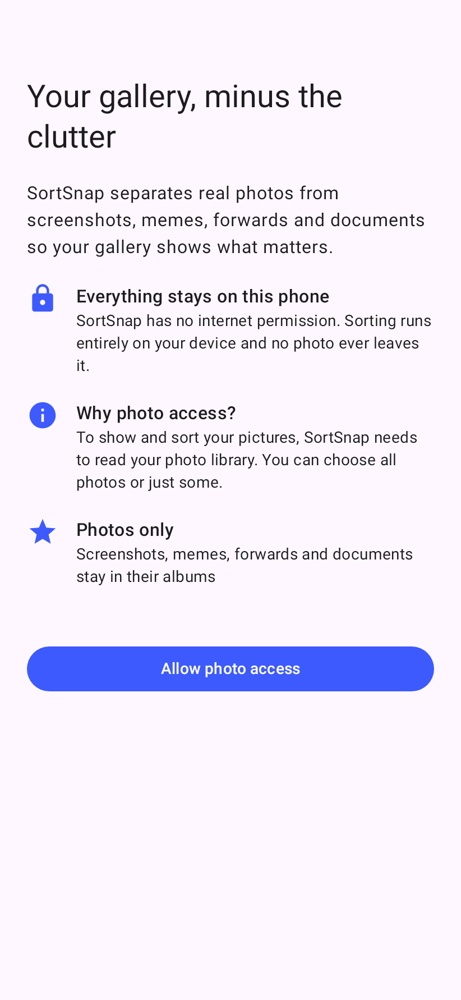
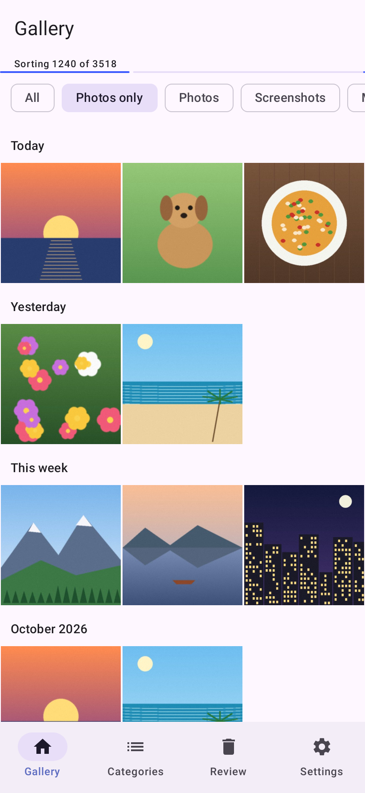
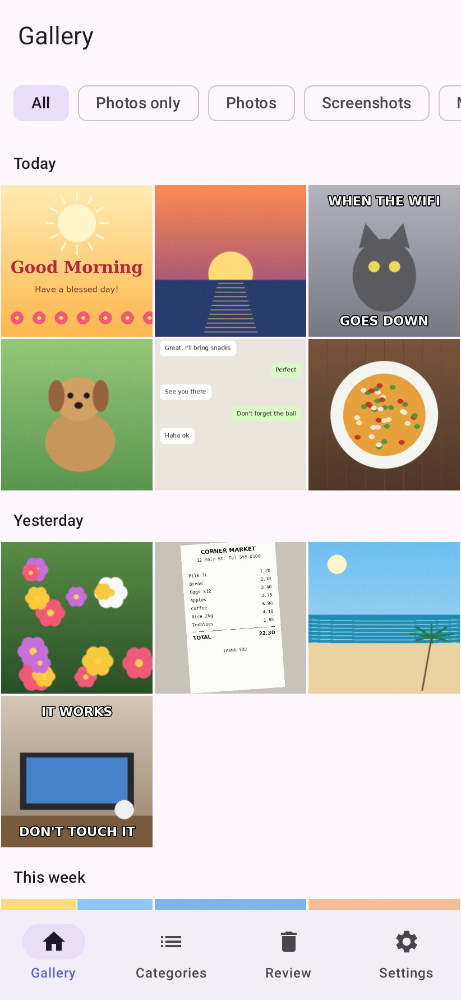
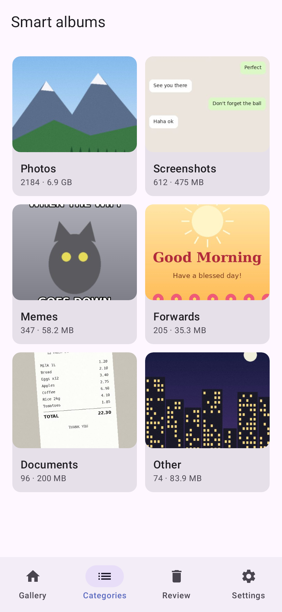
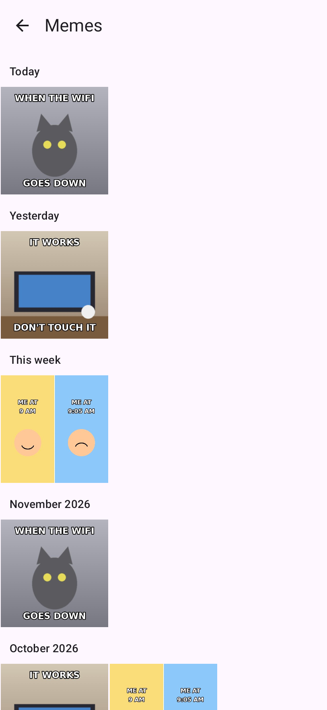
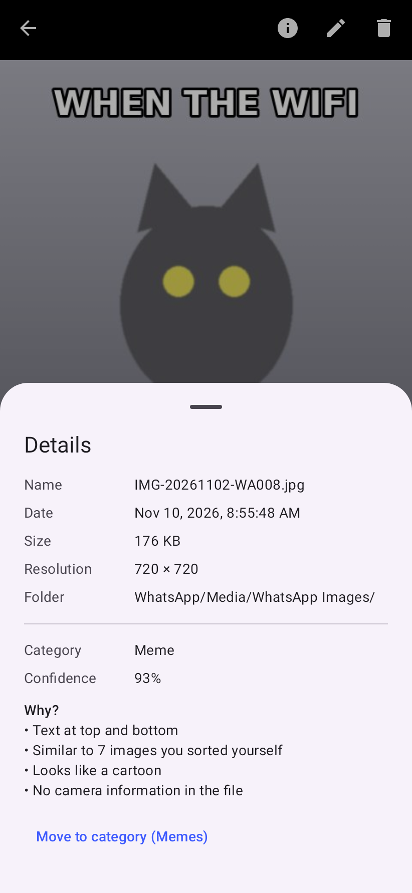
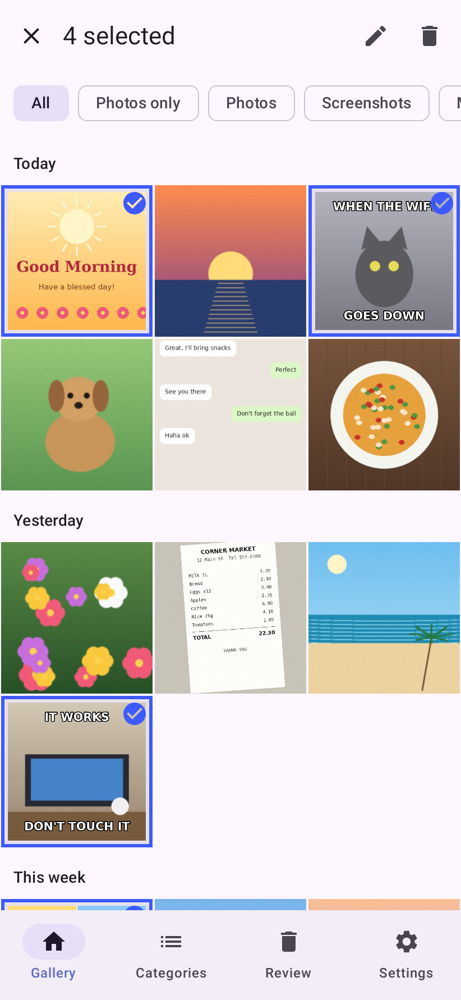
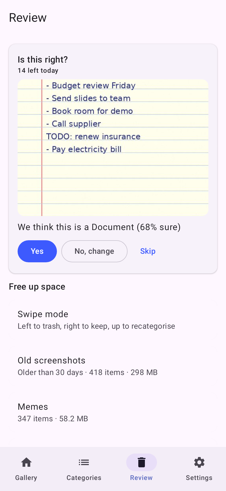
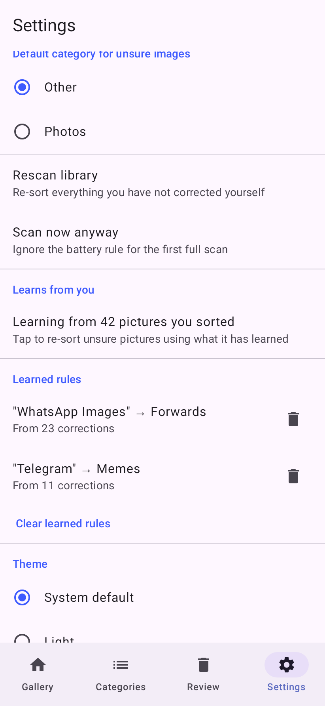

# Getting started with SortSnap

A five-minute tour for new users. SortSnap is a photo gallery that sorts your pictures into
**Photos, Screenshots, Memes, Forwards, Documents** and **Other**, so your gallery shows your real
photos first. Everything happens on your phone: the app has no internet permission.

> These images are the app's real screens rendered with sample pictures (drawn illustrations, not
> anyone's photos). Your phone's colours may differ: SortSnap follows your wallpaper colours on
> Android 12 and newer.

## 1. Allow photo access

The first screen explains what SortSnap does and that nothing leaves your phone. Tap
**Allow photo access**.

- On Android 14 and newer you can pick **All photos** or only some. With only some, a banner at the
  top of the gallery lets you allow the rest later.
- If you said no by mistake, the screen offers a button to open the app's system settings.

 

## 2. Your gallery, sorted as it scans

Your pictures appear straight away, grouped by **Today, Yesterday, This week** and month.

- The thin bar under the title shows sorting progress (*Sorting 1240 of 3518*). It runs in the
  background, so you can keep using the app or close it.
- The first full sort waits until your phone is charging or above 30 % battery. To start anyway, go to
  Settings › **Scan now anyway**.
- **Photos only** is on by default: screenshots, memes, forwards and documents are kept out of the
  main view. Nothing is deleted.
- Pinch the grid to switch between 3, 4 and 5 columns.

 

## 3. Filter what you see

Use the chips under the title:

- **All** shows every picture, including the clutter.
- **Photos only** hides the clutter (the default).
- **Photos, Screenshots, Memes, Forwards, Documents, Other** show one category.

Tap a picture to open it full screen. Swipe left and right to move between pictures, pinch or
double-tap to zoom.

 

## 4. Browse by category

The **Categories** tab shows a smart album for each category, with how many pictures it holds and how
much space they use. The numbers update live while sorting runs.

**Other** holds pictures SortSnap is not sure about. They are never hidden, so nothing goes missing.

 

## 5. Open an album

Tap a tile to open that album. It works like the gallery: tap to view, long-press to select.

 

## 6. See why a picture was sorted

In the full-screen viewer, tap **ⓘ** to open the details. Next to the file name, date, size and
folder you see the **category**, how **confident** SortSnap is, and a **Why?** list in plain words,
for example *Text at top and bottom* or *Similar to 7 images you sorted yourself*.

The other buttons at the top: ✏️ moves the picture to another category, 🗑 sends it to the trash.

 

## 7. Fix mistakes (SortSnap learns from them)

Long-press a picture to start selecting, then tap more pictures. In the bar at the top:

- ✏️ **Move to category**: pick the right category. Your choice always wins and a rescan never
  changes it back.
- 🗑 **Trash**: Android asks you to confirm. On Android 11 and newer, trashed pictures can be
  restored for 30 days.

Every correction teaches SortSnap. After about 5 corrections from the same folder, it learns a
folder rule (for example *WhatsApp Images → Forwards*). Pictures that look like ones you sorted
yourself get sorted the same way.

 

## 8. Review: confirm and free up space

The **Review** tab has two parts:

- **Is this right?** Each day SortSnap shows up to 20 pictures it is unsure about. Tap **Yes**,
  **No, change** (pick the right category) or **Skip**. A few taps a day makes sorting noticeably
  better.
- **Free up space**: old screenshots (over 30 days), memes, forwards, near-duplicates (the largest
  copy is kept) and blurry photos, each with how much space you would get back. Open a section,
  tap pictures to keep them, and trash the rest. Or try **Swipe mode**: left to trash, right to keep,
  up to change the category, with undo.

 

## 9. Settings

- **Hide clutter from main gallery**: turn Photos only on or off by default.
- **Default category for unsure images**: *Other* (safest) or *Photos*.
- **Rescan library** re-sorts everything you have not corrected yourself.
- **Learns from you** shows how many of your corrections it is using. Tap it to re-sort unsure
  pictures with what it has learned.
- **Learned rules** lists folder rules. Tap 🗑 to delete one you disagree with.
- **Theme**: system default, light or dark. **Dynamic colour** follows your wallpaper colours.

 

## Good to know

- SortSnap never deletes anything without asking you. Android shows its own confirmation every time.
- Your corrections are kept when you rescan or update the app.
- Big libraries (50,000+ pictures) are fine: sorting happens in the background in small batches.

---

For developers: the screenshots are generated by `app/src/test/kotlin/com/sortsnap/ui/GuideScreenshots.kt`
(Robolectric, no emulator) with sample pictures from `tools/generate_sample_images.py`. Refresh them with
`./gradlew :app:testDebugUnitTest --tests '*GuideScreenshots*' -PguideDir=docs/screenshots`.
